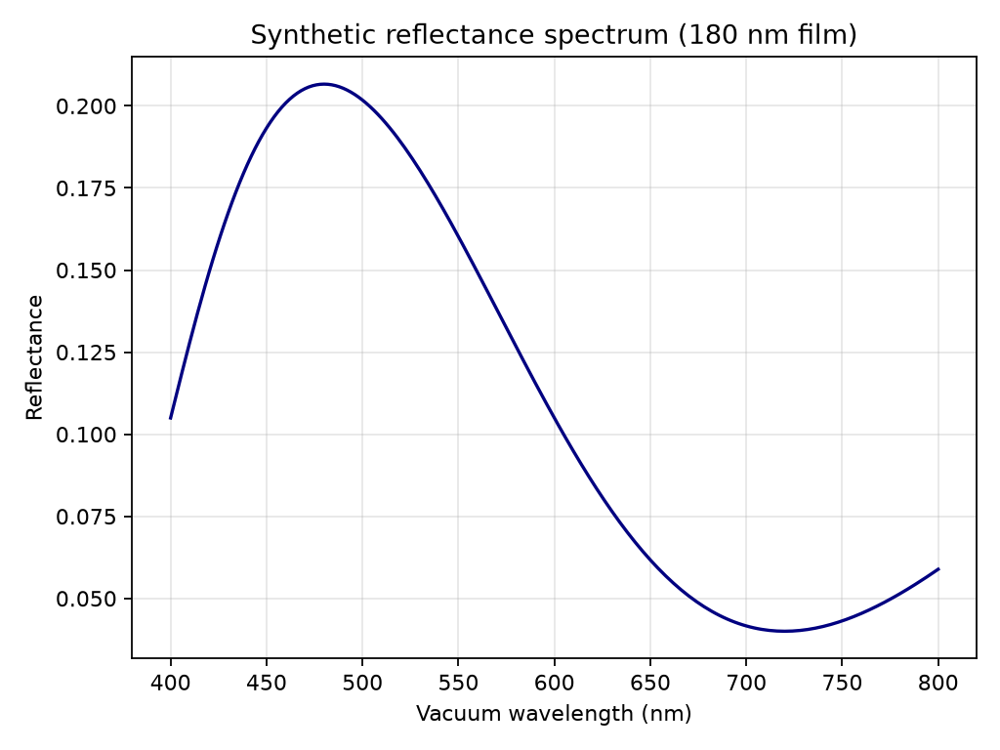
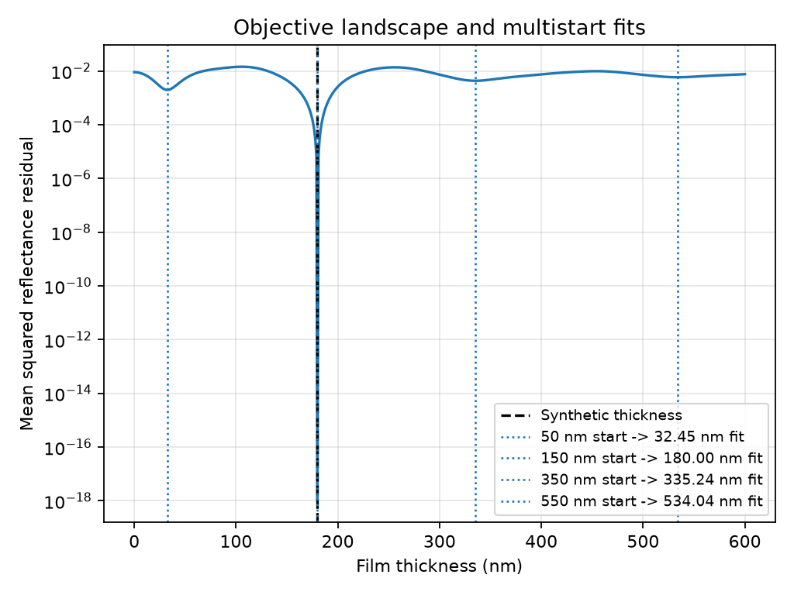
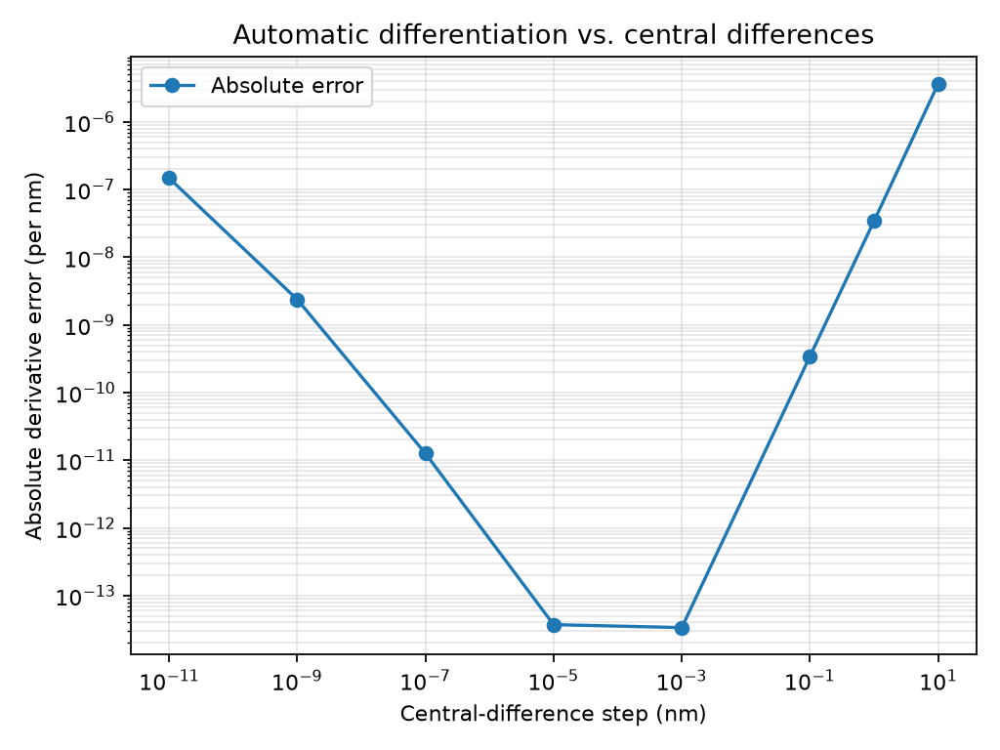
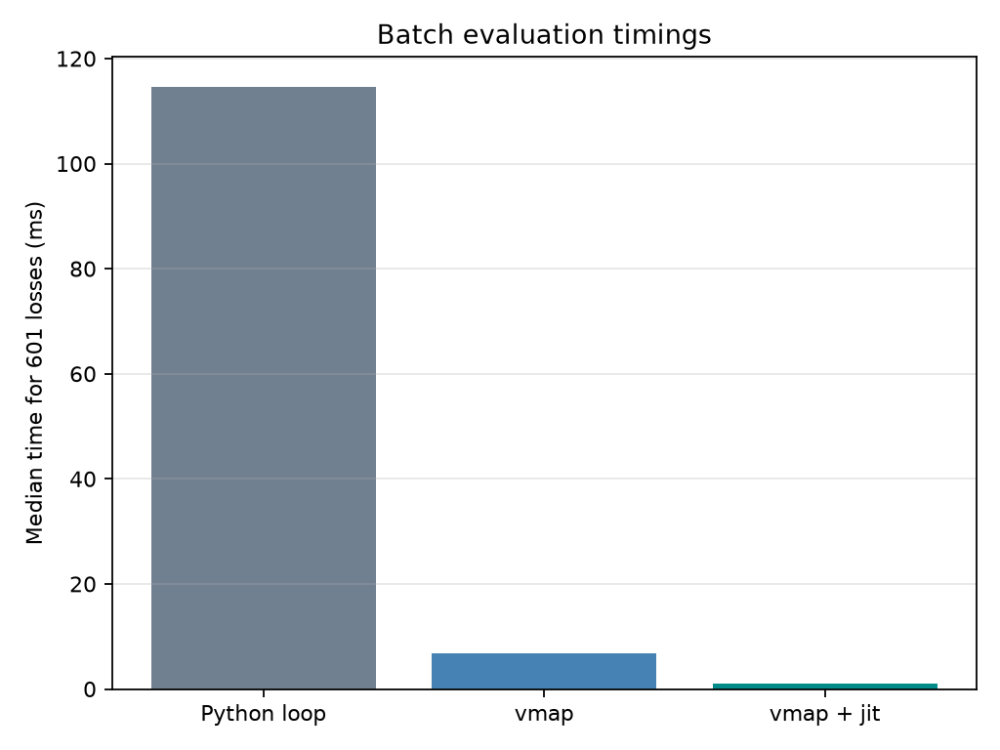

# Thin-film inverse modeling

This project models normal-incidence reflection from a finite coherent film between semi-infinite incident and substrate media. It uses real, wavelength-independent refractive indices. Thickness and vacuum wavelength are in nanometers.

## Model

For incident, film, and substrate indices \(n_0,n_1,n_2\), thickness \(d\), and vacuum wavelength \(\lambda\), the interface amplitudes and round-trip phase are

\[
r_{01}=\frac{n_0-n_1}{n_0+n_1},\qquad
r_{12}=\frac{n_1-n_2}{n_1+n_2},\qquad
\delta=\frac{2\pi n_1d}{\lambda},\qquad q=e^{2i\delta}.
\]

The reflected amplitude and reflectance are

\[
r=\frac{r_{01}+r_{12}q}{1+r_{01}r_{12}q},\qquad R=|r|^2.
\]

The implementation uses JAX float64 arrays. The inverse problem minimizes the mean squared reflectance residual over film thickness. SciPy's L-BFGS-B optimizer receives the scaled parameter \(u=d/100\), so its gradient is \(dL/du=100\,dL/dd\).

## Reproduce

From the repository root, install the package with test dependencies and run the tests:

```bash
python -m pip install -e ".[test]"
python -m pytest
```

Generate the synthetic measurements, fits, figures, derivative check, and timings:

```bash
python -m thin_film_inverse
```

The command writes `results/results.json` and four PNG figures. It also works after installation as `thin-film-inverse`. Imports define the model and experiment functions without running the experiment.

## Baseline experiment

The synthetic spectrum has 201 wavelengths from 400 to 800 nm, a true thickness of 180 nm, and indices \(n_0=1\), \(n_1=2\), and \(n_2=1.5\). The objective is mean squared reflectance residual. The thickness search spans 0 to 600 nm and evaluates 601 candidates against one fixed spectrum.

`results/results.json` records recomputed fit values, derivative comparisons, noisy recovery, timing samples, and environment details. At 150 nm, the reference loss is 0.004482128954 and its derivative is -0.000258846533 per nm. The four L-BFGS-B starting thicknesses (50, 150, 350, and 550 nm) converge to 32.45, 180.00, 335.24, and 534.04 nm, respectively. Only the 150 nm start reaches the synthetic thickness; the other starts settle in distinct local minima.

The noisy example adds seeded Gaussian noise with standard deviation 0.005 in reflectance units. With seed 2026, the fit from 150 nm recovers 179.92095 nm, an error of -0.07905 nm.

## Figures









The derivative check compares JAX automatic differentiation with central finite differences at 150 nm, away from the optimum. The batch timing compares a Python loop, `vmap`, and `vmap` plus `jit` on the same 601 candidates and 201-point spectrum. Each method is warmed, the first call is reported separately, and steady-state measurements are synchronized with `block_until_ready()`. The timing run repeats each measurement seven times and reports the median. In the recorded CPU run, the medians were 114.60 ms for the loop, 6.77 ms for `vmap`, and 0.96 ms for `vmap` plus `jit`; the JSON records first-call times and all samples. Plotting is excluded from timing.

## Tests

The focused tests cover bare-interface and index-matching limits, quarter-wave antireflection, derivative agreement, loop/vectorized/compiled agreement, noiseless thickness recovery, and optimizer gradient scaling. Continuous integration installs the package and runs pytest on Python 3.12.
